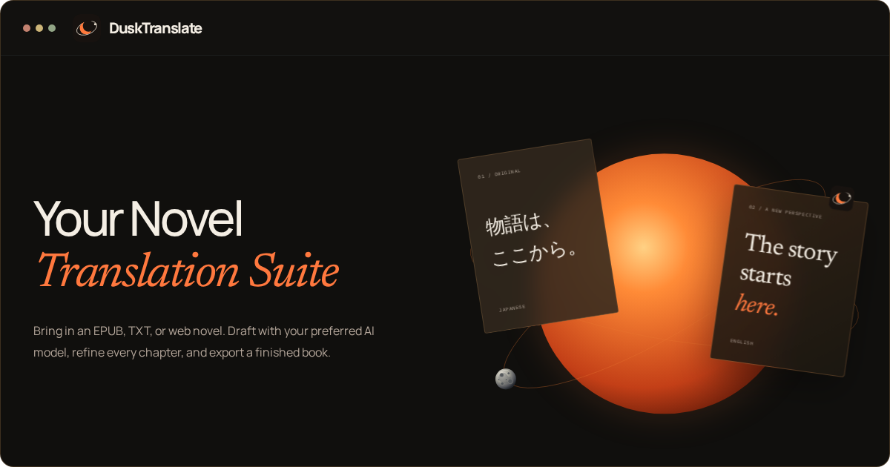

# DuskTranslate

<p align="center">
  <a href="https://www.dusktranslate.com">
    
  </a>
</p>

<p align="center"><strong>Your novel translation suite for MTL, editing, review, and EPUB export.</strong></p>

<p align="center">
  <a href="https://www.dusktranslate.com">Open DuskTranslate</a> |
  <a href="https://www.dusktranslate.com/guides/api-keys.html">API key guide</a> |
  <a href="https://github.com/eye9444/Dusk-Translate/releases">Releases</a>
</p>

## What It Does

DuskTranslate is a browser-based workspace for translating and managing novels. Import EPUB, TXT, JSON, or saved project files, generate an MTL draft with your own provider key, edit chapter by chapter, and export the result as TXT or EPUB.

- Japanese, English, Vietnamese, Russian, German, Spanish, Italian, Portuguese, Korean, and Simplified Chinese routes, including supported source-to-English workflows
- Side-by-side source and translation editing with glossary and custom prompt support
- Local projects through IndexedDB, or private cloud projects when signed in
- Built-in EPUB reader, backups, public reader links, and EPUB/TXT export
- Optional team review stages for translators, proof-readers, quality checkers, and leads
- Google AI Studio, OpenRouter, OpenAI, Claude, and compatible HTTPS providers

Japanese-to-English is the primary route. Translation requests use the provider and API key selected by the user; provider charges still apply. Current features are free, and optional [PayPal support](https://paypal.me/eye9444) helps cover hosting and development.

## Typical Workflow

1. Create a project from an EPUB, TXT, JSON, or backup file.
2. Choose a supported source and target language, provider, and model.
3. Translate chapters, refine the output, and maintain terminology in the glossary.
4. Save locally or sync privately, review the work, then export or share it through a reader link.

## Run Locally

```bash
npm ci
npm run dev
```

Useful checks:

```bash
npm test
npm run build
npm run test:e2e
npm run test:auth
npm run test:modules
```

For a guest-only local preview:

```bash
VITE_LOCAL_ONLY=true npm run dev
```

## Project Layout

- `web/` - hosted application, editor, reader, and styles
- `api/` and `server/` - hosted API and server-side access logic
- `tests/` - unit, browser, authentication, and security tests
- `supabase/` - database migrations and access policies
- `scripts/` - build and validation helpers
- `docs/` - architecture, setup, and release documentation

## Privacy

Account storage is optional. Projects are stored locally unless cloud sync is chosen, and provider API keys are not saved with project or account data by default. See the [Privacy Policy](https://www.dusktranslate.com/privacy.html), [Terms](https://www.dusktranslate.com/terms.html), and [Cookie Policy](https://www.dusktranslate.com/cookies.html).

## License

No license has been selected for this repository yet. Until a license is added, reuse and redistribution are not granted by default.
