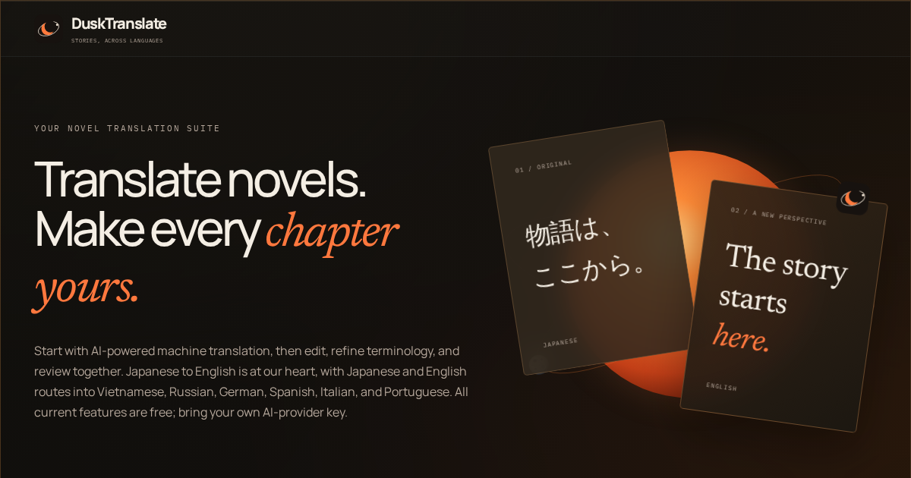
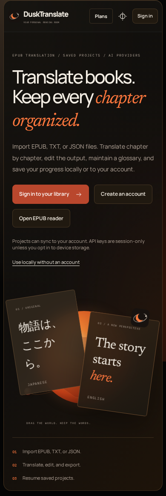

# DuskTranslate

<p align="center">
  <a href="https://www.dusktranslate.com">
    
  </a>
</p>

<p align="center">
  <strong>A novel translation suite: AI-powered MTL, editing, and team review in one place.</strong>
</p>

<p align="center">
  <a href="https://www.dusktranslate.com"></a>
  
  
</p>

## Open the Web App

### Version 0.6.0

- Right-click a chapter (or focus it and press Shift+F10) for bulk completion, unfinished status, and confirmed deletion. Normal clicks still open chapters. Empty translations cannot be marked complete. The uploaded original is retained; deleted EPUB sections and optionally their unused images are removed from translated exports.
- Feedback Hub supports private reporter/founder conversations, accepted/standby/rejected queues, detailed rejection reasons, and unread notifications while the site is open. Contact Eye on [Reddit](https://www.reddit.com/user/eye9444/) or [Discord](https://discord.gg/48btenHty2).
- Account cards show cloud project and storage usage instead of subscription status in community mode.
- Local collaboration writes no longer wait for network uploads. Startup replays pending edits before showing shared text, and EPUB export saves a local draft before building.

Self-hosted deployments require the feedback ticket, reader chapter state, and feedback status message length migrations. See [release notes](docs/RELEASE-NOTES.md).

**[Launch DuskTranslate](https://www.dusktranslate.com)** in a modern browser. No installation or downloaded HTML release is required.

You can use the local library without an account, or sign in with Google or email to maintain private cloud projects across sessions. AI-provider credentials remain in the current editor session by default; users may explicitly remember them on their own device for 30 days, but they are never stored with an account or project.

DuskTranslate is a novel translation suite with AI-powered machine translation (MTL) at its center. Japanese-to-English is its primary route, with Japanese and English also translating into Vietnamese, Russian, German, Spanish, Italian, and Portuguese. Organize source chapters, generate an MTL draft, refine terminology, review together, and export the result.

All current features are free, including custom prompts, advanced editing tools, and staged team review. Optional donations will support hosting and development; the payment link is not yet available. AI-provider charges still apply to your own keys. Cloud capacity remains bounded at 200 projects, 5 GB, and 10 people per project; no app-imposed daily translation-character limit applies in community mode.

## Current Web Release

- Import EPUB, TXT, JSON project, and backup files
- Translate Japanese into English, Vietnamese, Russian, German, Spanish, Italian, or Portuguese
- Translate English into Vietnamese, Russian, German, Spanish, Italian, or Portuguese
- Compare the source and editable translation side by side
- Maintain a project glossary for names and preferred terminology
- Save projects locally or sync them to a private signed-in library
- Rename, archive, restore, back up, and resume projects
- Read standalone EPUBs, source books, and completed translated books in the built-in reader
- Export translated work as TXT or EPUB
- Use Google AI Studio, OpenRouter, OpenAI, Claude, or a compatible HTTPS endpoint with your own API key
- Assign Translator, Proof-reader, Quality Checker, and Lead roles in optional team review stages
- Compare source text, base MTL, and submitted revisions before approving a final chapter
- Replace the translation master prompt with shared or personal instructions
- See release notes once per account and revisit them from the library
- Scan selectable Japanese source text with Yomitan using the documented iframe setting
- Work on desktop or mobile in light or Eclipse themes
- Spin the animated landing-page planet and discover its hidden time-acceleration sequence

## Typical Workflow

1. Open the website and create a project from an EPUB, TXT, or saved project file.
2. Enter a supported provider key, choose its model, and optionally remember the provider settings on your trusted device.
3. Translate one chapter at a time, edit the output, and maintain glossary terms as needed.
4. Return to the saved project later, read it in the built-in reader, or export the completed translation.

Need a provider key? The app links directly to its **[API key setup guide](https://www.dusktranslate.com/guides/api-keys.html)** from the translation workspace.

## Tech Stack

DuskTranslate is a client-side JavaScript application built with **Vite** and deployed on **Vercel**. It uses **Supabase Auth, PostgreSQL, and Storage** for optional accounts and cloud projects, **IndexedDB** for the device library, and **JSZip** for EPUB and backup processing. Translation requests go directly from the browser to the selected provider using the supplied key. Provider credentials are session-only by default, with an explicit 30-day device-storage option for trusted personal devices.

Testing uses the Node.js test runner, **Playwright**, and **PGlite**. The interface is authored with semantic HTML, modular CSS, native browser APIs, and accessible keyboard controls rather than a component framework.

Version changes in `package.json` are verified by GitHub Actions and automatically receive a matching `v*` tag and GitHub Release after the checks pass.

Only product features and bug fixes warrant version changes. Visual and aesthetic updates ship silently within the existing version, without a new tag, release, or What's New popup. The in-app What's New history contains feature updates only; bug-fix details belong in the GitHub release notes. When correcting announcement history, preserve account acknowledgements so users are not notified again about older features.

See **[Tech Stack and File Guide](docs/TECH-STACK.md)** for the complete architecture, data flow, security boundaries, generated files, and a description of every tracked file.

## Responsive Interface

The website is available on desktop and mobile. The intended way to use DuskTranslate is on a pc, however it can still be used with all its capabilities on mobile.

<p align="center">
  
</p>

## Run the Website Locally

```bash
npm ci
npm run dev
```

The development server prepares the embedded editor and starts Vite locally. Use these commands to verify a change before deployment:

```bash
npm test
npm run build
npm run test:e2e
npm run test:auth
```

Account and cloud-project features require Supabase environment variables. See **[Hosted Setup](docs/HOSTED-SETUP.md)** for the deployment configuration.

Community access requires migration `202610200001_community_access.sql` before deploying this release. It changes product entitlements, not administrative roles or existing subscriptions. Existing subscribers retain access to their billing portal and must cancel explicitly if desired.

Paid-plan testing is retained only for an isolated test database with `launch_configuration.community_access=false`, Paddle sandbox credentials, and a local Vite dev server with `VITE_PAID_TESTING=true`. Never disable community access in the production database for testing. Production checkout is blocked. See [community rollout notes](docs/COMMUNITY-ROLLOUT.md).

To refresh the README screenshots in Eclipse mode, run the preview server and then:

```bash
npm run screenshots:readme
```

## Active Project Structure

- `web/` contains the hosted application, editor integration, EPUB reader, legal pages, and styles.
- `config/` contains Playwright configuration for browser and mocked-auth verification.
- `tests/` contains unit, browser, authentication, and row-level-security tests.
- `supabase/` contains the cloud-project schema and access policies.
- `scripts/` prepares and validates the web application.
- `docs/` contains architecture and deployment documentation.

## Legacy Standalone Builds

Historical HTML builds are retained on the **[`legacy-standalone` branch](https://github.com/eye9444/Dusk-Translate/tree/legacy-standalone/releases)** and in the [`v0.1.0` release](https://github.com/eye9444/Dusk-Translate/releases/tag/v0.1.0). They are no longer the primary product or recommended way to use DuskTranslate. The default branch now contains only the hosted application and its supporting files.

## Privacy and Security

DuskTranslate does not include advertising or behavioral analytics. Account storage is optional, cloud projects are protected per user, and provider API keys are not saved with project or account data.

- [Privacy Policy](https://www.dusktranslate.com/privacy.html)
- [Terms and Conditions](https://www.dusktranslate.com/terms.html)
- [Cookie Policy](https://www.dusktranslate.com/cookies.html)
- [Architecture](docs/ARCHITECTURE.md)

## Status

The hosted web release is under active development. The current focus is reliability across project saving, chapter translation, EPUB reading and export, authentication, and responsive use.
